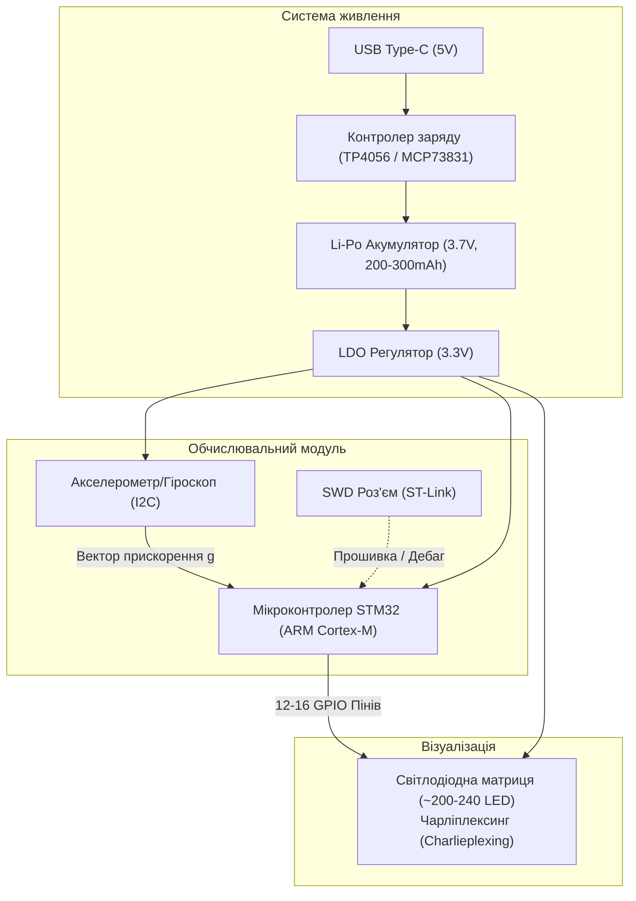

# Fluid Simulation Pendant — Дорожня карта та чеклист проєкту (ПОК)

> **Контекст проєкту**: Розробка автономного розумного кулона з фізичною симуляцією поведінки рідини на базі мікроконтролера та світлодіодної матриці.  
> **Команда**: 4 людини (високі вимоги до якості та глибини пропрацювання).  
> **Ментор**: Олексій (Tech Lead Sigma Software, випускник КН УКУ, асистент Павла Фаренюка).  
> **Ключові дедлайни**: 
> - **1-й захист**: **15 жовтня 2026** (~11 днів)
> - **Шопінг-ліст (Buy-list)**: **Кінець жовтня 2026**
> - **2-й захист**: Листопад (прошитий чіп через зовнішній програматор, власна розведена плата)
> - **3-й захист (Фінал)**: Грудень (готовий автономний пристрій у корпусі)

---

## 1. Головні висновки та філософія оцінювання
1. **«Готовий продукт» — ключ до найвищого балу**: Викладачі (Павло Фаренюк, Robotics) найбільше цінують реальний працюючий фізичний девайс у корпусі, а не просто слайди чи симуляцію на екрані монітора.
2. **Власна плата замість девборди**: Використання готової девборди — це безпечно, але розробка власної круглої плати під кулон — це значно вищий інженерний рівень і гарантія максимального балу.
3. **НЕ паяти SMD світлодіоди вручну паяльником**: 200–240 світлодіодів формату 0603/0402 вручну паяти надзвичайно важко й ризиковано. Рішення: замовляти фабричний монтаж (JLCPCB PCBA) або використовувати паяльну пасту + трафарет (stencil) + термостіл/фен.
4. **Кожен у команді має розуміти стек**: Всі 4 учасники мають розібратися з IDE, мікроконтролером, архітектурою коду та схемотехнікою, а не ділити команду на «один паяє, інші чекають».
5. **Fail-safe демки**: На захисті завжди демонструється девайс наживо, але обов'язково має бути записане якісне резервне відео (на випадок неочікуваних збоїв живлення чи контактів).

---

## 2. Чеклист до 1-го захисту (Дедлайн: 15 жовтня)

Мета першого захисту: чітко показати суть ідеї, теоретичний ресерч алгоритмів, сформовані інженерні вимоги, план закупівель та **1 працюючу річ (Proof of Concept)**.

### Блок А: Дослідження та робота з ресурсами
- [ ] **Зустріч з минулорічною командою (Дарина)**:
  - [ ] Забрати девборду STM32 минулорічної команди.
  - [ ] Провести Q&A: що було найскладнішим? Які граблі вилізли з матрицею, живленням чи тепловідводом?
  - [ ] Отримати їхній шопінг-ліст та схему для референсу.
- [ ] **Навчальні матеріали**:
  - [ ] Отримати описи лабораторних робіт по STM32 (взяти наперед).
  - [ ] Зареєструвати студентські ліцензії **Autodesk Fusion 360** (Student Pack).
  - [ ] Повторити базовий математичний апарат: вектори, чисельне інтегрування, дискретизація простору/часу.

### Блок Б: Вимоги до пристрою (System Requirements)
- [ ] **Функціональні вимоги**:
  - [ ] Реакція симуляції на нахил і прискорення кулона через IMU (акселерометр).
  - [ ] Відображення хвиль/крапель рідини на матриці при струшуванні.
  - [ ] Кнопка ввімкнення / зміни режимів (або автоматичний sleep mode при нерухомості).
- [ ] **Нефункціональні вимоги**:
  - [ ] **Габарити**: Діаметр кулона $\le 45\text{--}50\text{ мм}$, товщина $\le 10\text{--}12\text{ мм}$.
  - [ ] **FPS**: Цільова частота кадрів симуляції $30\text{--}60\text{ FPS}$ (без видимого мерехтіння).
  - [ ] **Роздільна здатність**: Матриця на ~200–240 світлодіодів.
  - [ ] **Автономність**:
    - [ ] Розрахувати енергоспоживання: струм MCU в активному режимі ($\approx 15\text{--}30\text{ mA}$) + струм матриці (динамічна індикація $\approx 20\text{--}50\text{ mA}$) + акселерометр ($\approx 1\text{ mA}$).
    - [ ] Розрахувати ємність Li-Po акумулятора (наприклад, 200–300 mAh $\implies 3\text{--}5$ годин безперервної роботи).
  - [ ] **Зарядка**: Контролер заряду Li-Ion/Li-Po (наприклад, TP4056 або компактніший аналог) через роз'єм USB Type-C.

### Блок В: Ресерч підходів до симуляції рідини
Підготувати порівняльну таблицю та обґрунтування для презентації:
- [ ] **Клітинні автомати (Cellular Automata / Falling Sand)**:
  - *Плюси*: Мінімальні вимоги до CPU/RAM, проста бітова логіка, ідеально лягає на LED матрицю.
  - *Мінуси*: Менш фізична передача інерції та хвиль без додаткових правил.
- [ ] **Частинковий метод (SPH — Smoothed Particle Hydrodynamics / 2D Particles)**:
  - *Плюси*: Реалістична поведінка крапель, взаємодія з вектором прискорення від IMU.
  - *Мінуси*: Потребує обрахунку парних сил взаємодії ($O(N^2)$ або $O(N)$ з grid hashing), потрібна арифметика з фіксованою точкою (fixed-point math), якщо MCU має обмежений FPU.
- [ ] **Сітковий метод (Eulerian Grid / Stable Fluids Jos Stam)**:
  - *Плюси*: Неперервне поле швидкостей і тиску.
  - *Мінуси*: Занадто «важкий» за пам'яттю та обчисленнями диференціальних рівнянь для ультракомпактного MCU.
- [ ] **Рішення команди**: сформулювати обраний підхід (наприклад, 2D particle simulation з раунденими координатами або гібридний клітинний автомат).

### Блок Г: Робоча демка (Proof of Concept) до 15 жовтня
- [x] **Software Sandbox (Готово! C++ Embedded Core + CLI)**:
  - [x] Реалізовано 2D симуляцію рідини на C++17 (`core/fluid_sim.cpp`, `core/fluid_sim.hpp`), оптимізовану під Cortex-M (нуль динамічної пам'яті в `step()`, 50 000+ FPS на CPU).
  - [x] Керування гравітацією, імпульсами та відцентровими вихорами з клавіатури / авто-обертання.
  - [x] Кругла матриця рівно на 240 світлодіодів (18x18 grid) з каліброваними рівнями заповнення (20%, 40%, 60%, 80%, 100%).
- [ ] **Hardware Sandbox**:
  - [ ] Запустити тестовий код на девборді STM32 від минулої команди (або на бредборді).
  - [ ] Засвітити світлодіоди, продемонструвати базове динамічне керування / біжучий вогник.

### Блок Д: Презентація до 1-го захисту
- [ ] Слайд 1: Концепція, ціль, склад команди.
- [ ] Слайд 2: Архітектура пристрою (MCU + IMU + Чарліплексинг матриця + Power).
- [ ] Слайд 3: Порівняння алгоритмів симуляції та наш вибір.
- [ ] Слайд 4: Таблиця вимог (FPS, розмір, струми, автономність, піни).
- [ ] Слайд 5: Демонстрація прототипу (відео або живе підключення пісочниці + плата).
- [ ] Слайд 6: План робіт до 2-го захисту та орієнтовний BoM (Bill of Materials).

---

## 3. Технічна архітектура кулона

### Як керувати 240 світлодіодами з малої кількості пінів?
- У дівчат було **240 світлодіодів на 12–16 пінах**.
- **Метод**: **Чарліплексинг (Charlieplexing)** або матричне динамічне сканування зі зсувними регістрами (74HC595) / спеціалізованими LED-драйверами (напр. IS31FL3731).
- Формула Чарліплексингу: $N$ пінів керують до $N \times (N - 1)$ світлодіодами:
  - 12 пінів $\implies 12 \times 11 = 132$ діоди.
  - 16 пінів $\implies 16 \times 15 = 240$ діодів!
- Піни мікроконтролера переводяться у три стани: `HIGH`, `LOW` та `Hi-Z` (високоімпедансний вхід), що дозволяє запалювати конкретні діоди послідовно через швидку динамічну індикацію за допомогою таймерів MCU.

---

## 4. Розподіл обов'язків у команді (4 людини)

| Роль | Основні обов'язки | Задачі до 1-го захисту |
| :--- | :--- | :--- |
| **1. Hardware & Power Lead** | Схемотехніка, розрахунок живлення, акумулятор, вибір компонентів, розведення плати в KiCad. | Розрахунок часу автономності, підбір Li-Po батареї та контролера заряду, BoM список. |
| **2. Embedded Firmware Dev** | Робота з STM32, налаштування STM32CubeIDE, драйвер Charlieplexing/матриці, I2C драйвер IMU. | Пройти 1-шу лабу STM32, налаштувати середовище, підняти динамічну індикацію на девборді. |
| **3. Algorithm & Physics Dev** | Математика симуляції рідини, оптимізація під Cortex-M (fixed-point math), робота з векторами гравітації. | Реалізувати 2D пісочницю симуляції на ПК, підготувати аналіз алгоритмів (SPH vs Grid vs CA). |
| **4. CAD Designer & QA / PM** | 3D-моделювання кулона у Fusion 360, корпус під 3D друк, презентація, координація та тестування. | Засетапити Fusion 360, підготувати концепт-рендер корпусу кулона, зібрати презентацію на 15.10. |

---

## 5. Дорожня карта до кінця семестру (Roadmap)

### Спринт 1: 4–15 жовтня (Підготовка до 1-го захисту)
- [x] Організаційний міт з Олексієм.
- [ ] Отримати девборду і матеріали від Дарини.
- [ ] Написати першу симуляцію в пісочниці.
- [ ] Запустити першу лабу на STM32 девборді.
- [ ] Сформувати список вимог і порівняння алгоритмів.
- [ ] **15 жовтня: Успішний 1-й захист.**

### Спринт 2: 16–31 жовтня (Закупівля та макетування)
- [ ] Скласти фінальний **Buy-list** (деталі, контролери, матриці, акумулятори, ST-Link).
- [ ] Замовити компоненти (з урахуванням доставки з Китаю / локальних магазинів).
- [ ] Дослідити програмування мікроконтролера через зовнішній програматор (ST-Link V2 / SWD).
- [ ] Портувати алгоритм симуляції на C/C++ для виконання на STM32.

### Спринт 3: Листопад (Розведення плати та 2-й захист)
- [ ] Розвести власну плату кулона в KiCad (кругла форма, розміщення світлодіодів, MCU, IMU).
- [ ] Вирішити питання монтажу SMD діодів (замовлення PCBA з монтажем або трафарет).
- [ ] Реалізувати опитування акселерометра по I2C і передачу вектору гравітації в симуляцію.
- [ ] **2-й захист: Демонстрація миготіння світлодіодами на власному чіпі через зовнішній програматор.**

### Спринт 4: Грудень (Корпус, інтеграція та фінальний захист)
- [ ] Спроєктувати корпус кулона у Fusion 360 (розміщення плати, лінзи/розсіювача, батареї).
- [ ] Надрукувати корпус на фотополімерному (SLA) або FDM 3D-принтері.
- [ ] Фінальна збірка автономного кулона.
- [ ] Записати демонстраційне відео (резервний бекап для захисту).
- [ ] **3-й захист (Фінал): Демонстрація готового фізичного продукту.**

---

## 6. Найближчі практичні кроки (Next Steps)
- [ ] Написати Дарині щодо передачі девборди STM32 та референсних матеріалів.
- [ ] Встановити та налаштувати STM32CubeIDE усім 4 учасникам команди.
- [ ] Створити пісочницю для 2D-симуляції (веб-канвас або C++/Python) для швидкого тестування взаємодії з гравітацією.
